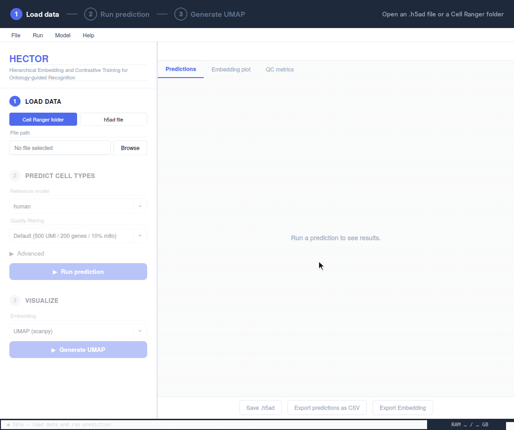

# HECTOR Desktop

https://github.com/Polligator/HECTOR-Desktop/releases

HECTOR Desktop is a graphical application for single-cell annotation. It loads data, predicts cell types, and creates interactive embeddings in one workflow.

## macOS installation

Download the macOS DMG from [Releases](https://github.com/Polligator/HECTOR-Desktop/releases), open it, and copy **HECTOR Desktop.app** to **Applications**.

The app is not Developer ID-signed or notarized by Apple. If macOS blocks it because the developer cannot be verified, only approve it if you trust this download:

1. Try opening **HECTOR Desktop** from Applications, then dismiss the warning.
2. Open **System Settings → Privacy & Security**.
3. Find the message about HECTOR Desktop and click **Open Anyway**.
4. Authenticate if asked and confirm opening the app.

This creates an exception for this app; do not disable Gatekeeper globally. If macOS reports malware or that the app is damaged, do not override that warning. On a managed Mac, contact your administrator if approval is unavailable. See [Apple's instructions](https://support.apple.com/en-us/102445).

## Use

1. Open an `.h5ad` file or a Cell Ranger output folder. The app also detects compatible OCM outputs.
2. Run prediction. Only human and mouse data are supported; the app selects the matching model from your data and downloads it automatically on first use.
3. Explore UMAP or t-SNE results, export plots, and save the annotated `.h5ad` file.

HECTOR uses Ensembl gene identifiers. When needed, the app can map gene symbols to Ensembl IDs before prediction.

On Apple silicon Macs, prediction and UMAP use Metal acceleration. Windows builds run on the CPU, which is noticeably slower. Times vary with hardware and dataset size.

For scripted or advanced workflows, use the [HECTOR](https://github.com/Polligator/HECTOR) Python package. Install it with `pip install hector-sc`. Tutorials are at <https://polligator.github.io/HECTOR/>.

For species other than human and mouse, try [HECTOR Pro](https://github.com/Polligator/HECTOR-Pro), an experimental multi-species model.
